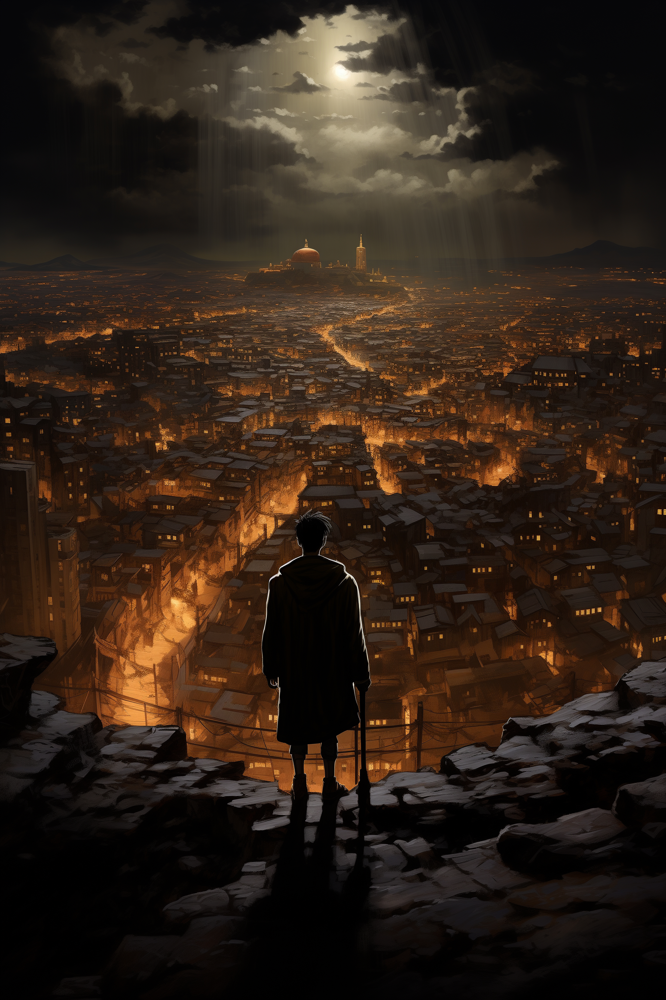

# Dark Tower: Mid-World Survival & Expedition
**A 3D Dark Fantasy Survival, Gunslinger Combat, and Expedition Engine built in Godot 4.**

---

## 🤠 About the Game

**Dark Tower: Mid-World Survival** is a 3D dark-fantasy survival, expedition, and wave defense action engine inspired by the grim, post-apocalyptic atmosphere of Stephen King's *The Dark Tower*.

The world has moved on. As a Gunslinger journeying through the ruins of Mid-World toward the Dark Tower, you must survive harsh anomaly storms, manage physical health and mental sanity, defend waystation campsites, and fight alongside loyal Ka-tet companions against corrupted beasts and cybernetic guardians.

---

## ✨ Key Features & Mechanics

* 🤠 **Gunslinger Combat & ADS Shooting:** Tactical 3D third-person shooter with Aim-Down-Sights (RMB), recoil, and 2.5x critical headshot locational damage.
* 🧠 **Sanity & Anomaly Storms:** Manage mental stability against dark corruption aura and periodic Beam Storm anomalies. Seek shelter at waystation campsites or light Beam Energy Lanterns.
* 🐺 **Ka-tet Companions (Oy & Automatons):** Smart AI companions that follow the player, scan for threats, fight in combat, and automatically gather scavenged loot.
* 📜 **Gunslinger Skill Tree & Progression:** Gain XP from combat and expeditions to level up and unlock perks (*Fan the Hammer*, *Iron Will*, *Quick Reload*, *Bounty Hunter*).
* ⛺ **Campsites & Expedition Waystations:** Deployable campsites for resting, health/sanity restoration, weapon repairs, and defending against nighttime wave sieges.
* 🌀 **Dimensional Doors & Fast Travel:** Interconnected waystation portals for fast travel between ruins and entering expedition dungeons.
* 🛒 **Balanced In-Game Store & Economy:** Dual-currency shop (Scrap Marks & Premium Marks) for purchasing maintenance tools, ammunition, and optional cosmetic skins with zero Pay-to-Win.
* ⌨️ **Radial Selection & Command Wheels:** Radial menus for quick item usage (`Q`), weapon swapping, and directing companion behavior (`Tab`).

---

## 🎮 Controls

| Action | Input Key |
| :--- | :--- |
| **Move** | `W`, `A`, `S`, `D` |
| **Shoot Weapon** | `Left Mouse Button` |
| **Aim Down Sights (ADS)** | `Right Mouse Button (Hold)` |
| **Reload Weapon** | `R` |
| **Quick Item Wheel** | `Q` |
| **Companion Commands Wheel** | `Tab` |
| **Open In-Game Store** | `B` |
| **Drop Selected Item** | `G` |
| **Interact / Waystation Door** | `E` |

---

## 🚀 Quick Start & Installation

1. Clone this repository and open the project directory in **Godot Engine 4.x**.
2. Open the main scene: `Scenes/Main.tscn`.
3. Press **F5** (or click **Play**) to launch the game.

---

## 🏛️ Project Architecture

Built upon an extensible, data-driven simulation framework:
* **UESS (Universal Entity Streaming System):** Efficient spatial chunk loading and persistent save/load via `SaveManager.gd`.
* **Modular Combat & AI:** Decoupled `Weapon3D.gd`, `EnemyBase3D.gd`, `CompanionBase3D.gd`, and `InGameStore.gd` architectures.
* **Physics & Terrain:** Powered by Godot Jolt 3D Physics and `Terrain3D`.

---

## ⚖️ Licensing

* **Client Code & Engine:** **[GPLv3](LICENSE)** - Open-source derivatives guarantee.
* **Assets & Models:** **[CC BY-SA 4.0](Assets/README.md)**.
